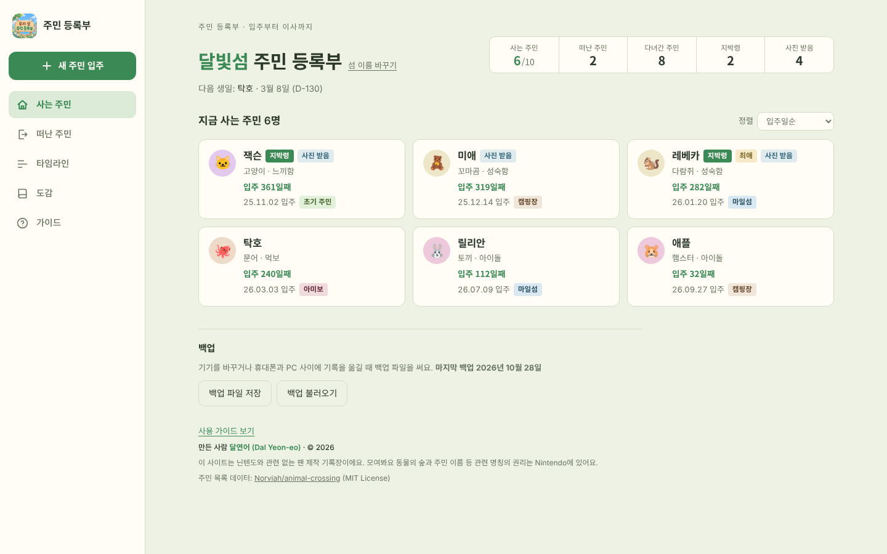

# 우리 섬 주민 등록부

모여봐요 동물의 숲(Nintendo Switch) 섬 주민의 입주부터 이사까지 기록하는 개인 기록장이에요.

### PC 화면

## 특징

- 로그인 없이 바로 쓸 수 있어요.
- 기록과 사진은 각자의 기기 브라우저에만 저장돼요. 같은 주소를 쓰는 사람끼리 기록이 섞이지 않아요. 휴대폰과 PC를 같이 쓰려면 백업 파일로 옮겨요.
- 모여봐요 동물의 숲 주민 기준으로, 2.0 업데이트와 산리오 콜라보 주민을 포함한 413명의 이름, 종족, 성격, 생일, 말버릇이 들어 있어서 이름만 치면 자동으로 채워져요.
- 입주일과 이사 간 날은 정확한 날짜, 몇 월쯤, 기억 안 남 중에서 골라 기록할 수 있어요.
- 이사 경로, 지박령, 최애, 주민 사진 받음, 스크린샷 앨범, 함께한 날들 기록을 지원해요.
- 타임라인, 이사 경로 통계, 주민 도감(만난 주민 수)을 볼 수 있어요.
- 백업 파일로 저장하고 불러올 수 있어요.
- 휴대폰에서는 하단 탭, PC에서는 왼쪽 메뉴로 화면이 바뀌어요. PC에서는 사진을 끌어다 놓거나 Ctrl+V로 붙여 넣을 수 있고, N(새 주민)과 1~5(탭 이동) 단축키를 쓸 수 있어요.
- 가이드 탭에서 등록부터 백업까지 사용법을 볼 수 있어요.
- 홈 화면에 추가하면 앱처럼 열려요.

## GitHub Pages로 올리기

1. 새 저장소를 만들고 이 폴더의 파일을 모두 올려요.
2. Settings → Pages에서 Branch를 `main`, 폴더를 `/ (root)`로 고르고 Save해요.
3. 1~2분 뒤 `https://아이디.github.io/저장소이름/` 주소로 열려요.

링크 미리보기 이미지가 메신저에서 안 보이면, `index.html`의 `og:image` 값을 `https://아이디.github.io/저장소이름/preview.png`처럼 전체 주소로 바꿔 주세요.

## 만든 사람

달연어 (Dal Yeon-eo) · [@Dalyeoneo-cmd](https://github.com/Dalyeoneo-cmd)

## 알림

이 사이트는 Nintendo와 관련 없는 팬 제작물이에요. 모여봐요 동물의 숲과 관련 명칭의 권리는 Nintendo에 있어요.
주민 목록 데이터는 [Norviah/animal-crossing](https://github.com/Norviah/animal-crossing)(MIT License)에서 가져왔어요. 자세한 내용은 `THIRD_PARTY_NOTICES.txt`를 봐 주세요.
